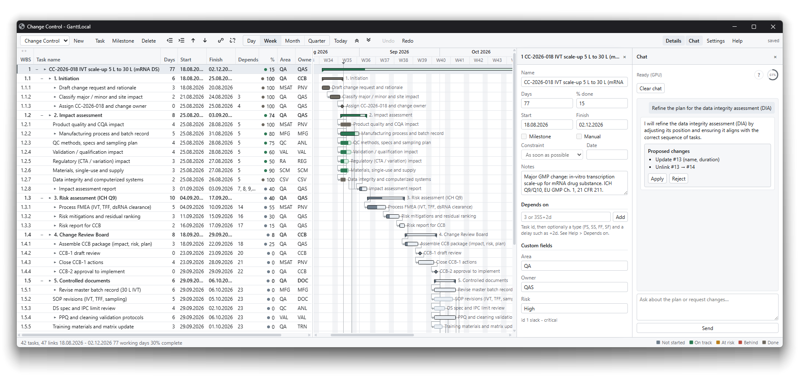

# GanttLocal

GanttLocal is a local project scheduler (Gantt chart) in plain HTML, CSS, JavaScript and Python.
Everything is stored on your machine: there is no account and no cloud.



## How to install

1. Install [Python 3](https://www.python.org/downloads/) and add it to PATH.
2. Copy this folder onto the machine.
3. Double-click `Install-assistant.cmd` - installs `pip` and the Python packages in `requirements.txt`. GPU: `Install-assistant-gpu.cmd`.
4. Double-click `GanttLocal.cmd`.

Optional Chat model - save as `llm/models/chat.gguf`:

[https://huggingface.co/bartowski/Qwen_Qwen3-14B-GGUF/resolve/main/Qwen_Qwen3-14B-Q4_K_M.gguf](https://huggingface.co/bartowski/Qwen_Qwen3-14B-GGUF/resolve/main/Qwen_Qwen3-14B-Q4_K_M.gguf)

## Start

Double-click `GanttLocal.cmd`. It starts the server, opens the app in its own window
without tabs or an address bar, and stops the server again as soon as you close that
window. There is no console window and nothing keeps running afterwards.

The plain window needs a Chromium based browser (Edge, Chrome, Brave, Vivaldi); with
anything else the app opens as a normal tab in your default browser, and closing the tab
still stops the server.

Running `GanttLocal.cmd` a second time does not start a second server: it opens another window
onto the one already running. The server stops when the last window is gone.

`start.cmd` is the variant for looking behind the scenes: it keeps a console window with
the server log open, and runs until you press Ctrl+C. Equivalent to:

```
python serve.py [port] [--auto-exit] [--app-window] [--no-browser]
```

The app is served at `http://127.0.0.1:8765/`; if that port is busy the next free one is
used and printed.

### How the shutdown works

Each open window holds one connection to `/api/session` open for its whole life. The
server counts those connections and exits a few seconds after the last one drops, which
is also why a reload does not stop it. This is deliberately not a timer-based heartbeat:
browsers throttle timers in windows that are not in front, which would kill the server
while you work in another program.

## Data

One JSON file per project in `data/`. Every edit is auto-saved about half a second after
you stop typing, atomically (write to a temp file, then replace), and the previous
contents are kept in `data/.backups/` (last 10 versions per project). Nothing else on
the machine is touched. If another process changes the open file, the status bar shows
*file changed*: click it to reload from disk, or Ctrl+S to overwrite with this window.

Switch or create projects with the leftmost toolbar control. `Settings > Export JSON`
writes a copy through the browser's download folder, `Import JSON` adds a file as a new
project. `Export HTML` writes a single view-only page (table and chart, no toolbar) that anyone
can open without the app or the server.

## Colour

The chart uses colour for one thing only: whether a task is as far along as it should be
by today. The yardstick is the working time already spent, so 20% done is fine on a task's
first day and alarming on its last.


| Colour     | Meaning                                                            |
| ---------- | ------------------------------------------------------------------ |
| grey       | not started, today is before its first working day                 |
| green      | on track, at least as far along as the time spent                  |
| amber      | at risk, up to 10 percentage points short                          |
| red        | behind, more than 10 points short, or past its finish and not done |
| grey-green | done, marked 100%, even if it finished late                        |


The solid part of a bar is the percentage entered, the pale part what is left. Summary
bars and the dot in the `%` column follow the same code, and a legend sits in the status
bar. Because colour is reserved for this, critical tasks are marked with a dark outline
and a small caret in the table instead.

## Help

`Help` in the toolbar, or `F1`, opens a window that explains the vocabulary in plain
language: what a dependency is, what the four types mean with a diagram each, lag,
constraints, summaries, milestones, critical path and slack, plus every shortcut.

## Dates

Dates are shown as `DD.MM.YYYY`. Typing accepts that form plus `19.8.26`, `19.8.` (current
year) and `2026-08-19`. Inside the JSON file dates are always stored as `YYYY-MM-DD`, so
the files stay unambiguous and sortable. `Settings > Date format` switches the display to
ISO if you prefer it.

## Scheduling

- Rows are an outline: a task with deeper rows below it is a summary task, and its dates,
duration and percentage roll up from its children.
- Durations are in working days, defined by the working-day and holiday settings.
- Dependencies support all four types with lag: `FS`, `SS`, `FF`, `SF`, for example
`12FS+2d` typed into the `Depends on` column (MS Project calls it Predecessors).
- A task with predecessors follows them. A task without predecessors sits on its own
start date. Dragging a bar later adds a start-no-earlier-than constraint; dragging it
back to the earliest possible date removes the constraint again.
- `Manual` on a task freezes its start date and ignores predecessors.
- Slack and the critical path are recomputed on every edit. Critical tasks get a dark
outline and a caret before the name; turn the marking off in Settings.
- Circular dependencies are refused when you create them, and reported in the status bar
if they are already in the file.
- A finish-driven link (`FF`, `SF`) into a summary task cannot be honoured, because a
summary's dates come from its children. Such a link is ignored and reported.

## Keyboard


| Key                            | Action                                                 |
| ------------------------------ | ------------------------------------------------------ |
| Arrows, Tab, Enter             | Move between cells, Enter or F2 edits                  |
| Typing                         | Starts editing the current cell                        |
| Ins / Del                      | Insert task below / delete selected tasks              |
| Alt+Shift+Left / Right         | Outdent / indent                                       |
| Alt+Shift+Up / Down            | Move a task and its children                           |
| Space                          | Collapse or expand a summary task                      |
| Ctrl+L                         | Link the selected tasks finish-to-start                |
| Ctrl+Z / Ctrl+Y / Ctrl+Shift+Z | Undo / redo                                            |
| Ctrl+S                         | Save now (also overwrites a file that changed on disk) |
| Ctrl+A                         | Select all rows                                        |
| F4                             | Task details panel                                     |
| F1                             | Help                                                   |


Mouse: drag a bar to move it, drag its edges to change the dates, drag the dot after a
bar onto another task to link them (Ctrl+drag from anywhere on the bar does the same),
double-click empty chart space to add a task at that date, double-click a bar for details,
drag the divider between table and chart to resize.

## Files


| File                        | Purpose                                                         |
| --------------------------- | --------------------------------------------------------------- |
| `GanttLocal.cmd`            | start the app in its own window, stop everything when it closes |
| `Gantt.cmd`                 | same; leftover name that starts `GanttLocal.cmd`                |
| `Install-assistant.cmd`     | `pip` + Python packages from `requirements.txt` (CPU)           |
| `Install-assistant-gpu.cmd` | same, then Vulkan `llama-cpp-python` wheel                      |
| `requirements.txt`          | Python packages for optional Chat                               |
| `start.cmd`                 | start with a visible server console instead                     |
| `serve.py`                  | static file server plus the project JSON API and HTML export    |
| `index.html`, `styles.css`  | application shell                                               |
| `js/model.js`               | document, mutations, undo/redo                                  |
| `js/schedule.js`            | dates, working-day calendar, scheduling, critical path          |
| `js/grid.js`                | virtualized table with inline editing                           |
| `js/timeline.js`            | canvas chart and drag editing                                   |
| `js/store.js`               | load, auto-save, import/export                                  |
| `js/chat.js`                | optional project chat dock                                      |
| `js/app.js`                 | wiring, toolbar, panels, shortcuts                              |
| `assistant/`                | local GGUF chat (optional)                                      |
| `llm/`                      | assistant models, settings, `requirements-assistant.txt`        |
| `tools/`                    | install scripts and helpers                                     |
| `tests/tests.html`          | engine checks, also runnable with `node js/tests.mjs`           |


## Optional local assistant

Chat (toolbar) can use a local GGUF model to discuss the open project and propose schedule edits.

1. Double-click `Install-assistant.cmd` (CPU) or `Install-assistant-gpu.cmd` (Vulkan GPU). Or run `python tools/install_assistant.py` / `python tools/install_assistant.py vulkan`. Plain pip: `[llm/README.md](llm/README.md)`.
2. Put instruct weights at `llm/models/chat.gguf` (recommended: [Qwen3-14B Q4_K_M](https://huggingface.co/bartowski/Qwen_Qwen3-14B-GGUF/resolve/main/Qwen_Qwen3-14B-Q4_K_M.gguf)). Thinking mode is disabled.
3. Restart GanttLocal and open **Chat**. Optionally enable **Settings → Assistant → Use GPU** after the Vulkan install.

Without those packages or weights, the scheduler runs as before; Chat reports that the assistant is not ready.

## Notes for locked-down Windows

- The core app uses only the Python standard library, so no `pip install` is needed for scheduling.
- The optional assistant needs `llama-cpp-python` and `llm/models/chat.gguf`.
- The server listens on `127.0.0.1` only, which does not trigger a firewall prompt.
- `GanttLocal.cmd` and `start.cmd` are batch files, so PowerShell execution policies do not apply.
- The app window uses its own browser profile under
`%LOCALAPPDATA%\GanttLocal\window`, so your normal browser, its extensions and its
session are untouched. Delete that folder to reset the window size.
- The page declares a content security policy of `default-src 'self'`: it cannot load or
contact anything outside this folder.

## License

[MIT](LICENSE). Use, copy, modify, share, and sell freely. Keep the copyright and
license notice.

## Disclaimer

Transparency is important to me. This project has been vibecoded. It is a personal
project. The example project in `data/` is purely artificial.